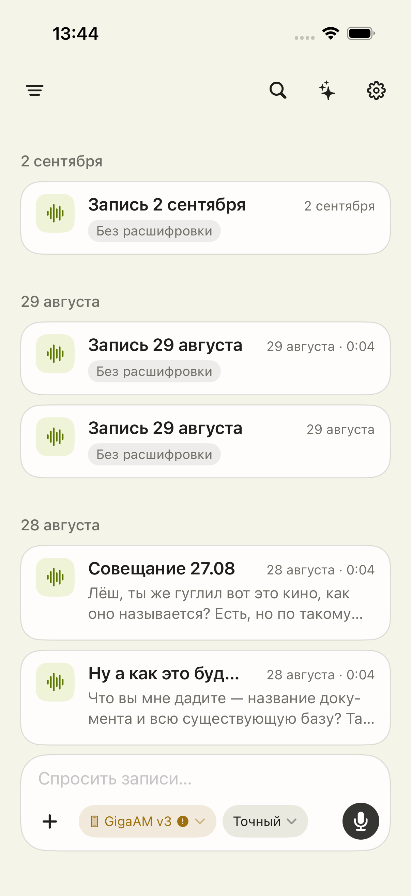
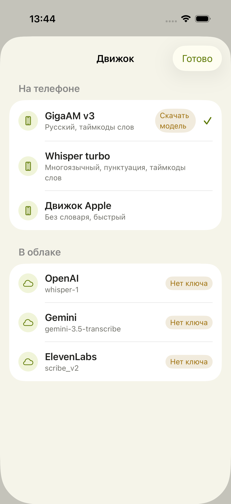
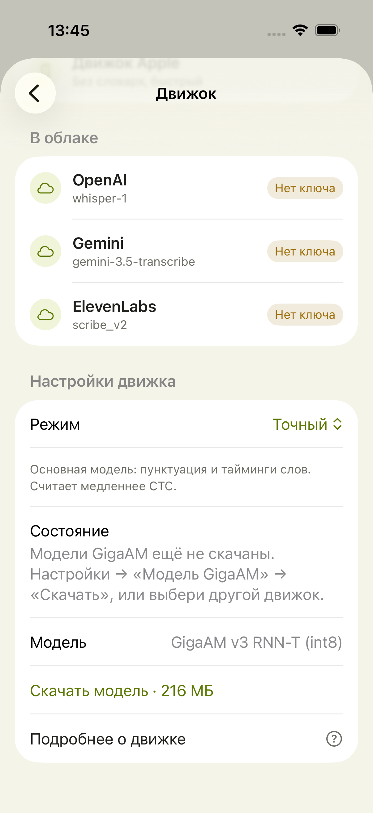

# Lori: аудит продукта и план до App Store

Дата: 7 сентября 2026. Объект: нативное iOS-приложение в текущем рабочем дереве, HEAD `1208f0c` плюс существующие незакоммиченные изменения. Код приложения в ходе аудита не менялся.

Уточнение при итоговом просмотре: рабочее дерево продолжает меняться. В нём уже появились `BackgroundTranscriptionTransport`, `TranscriptionJob` и `LocalTranscriptCheckpoint`, а также сохранение режима в расшифровке. Поэтому A6 ниже описывает исходный снимок аудита, а не отсутствие этих механизмов в последнем дереве. Их наличие ещё не доказывает надёжное восстановление: нужна отдельная проверка каждого движка на iPhone. Результаты UI-проверок в `VERIFICATION.md` относятся к указанной там сборке и не подтверждают последующие изменения. При повторном чтении кода риски перезаписи текста (A1), обработки прерываний микрофона (A2), восстановления из корзины (A3) и отсутствие Reduce Motion в `MotionBits` (A8) остаются актуальными.

## Вывод

У Lori есть основа самостоятельного продукта: запись и импорт, локальная обработка, собственные API-ключи, очередь, чтение с аудио, экспорт и вопросы по архиву с проверяемыми ссылками. Следующий этап — довести этот путь до надёжного повседневного инструмента. Добавление очередных моделей уступает по ценности сохранности записи, понятному первому запуску и быстрому переходу от вопроса к исходной фразе.

Предлагаемое обещание: **«Запиши разговор. Найди важное. Проверь по голосу. Ты выбираешь, где обрабатываются твои записи».**

Первая аудитория для проверки гипотезы — русскоязычные специалисты, регулярно записывающие рабочие разговоры и интервью. Не пытаться одновременно оптимизировать диктовку в любые приложения, лекции, командные встречи и медицинские протоколы. Начать с одного завершённого сценария: разговор 20–90 минут → расшифровка → найти решение → прослушать доказательство → отправить результат.

## Границы доказательств

- Статический разбор текущих Swift-файлов, конфигурации и существующих UI-тестов.
- Живой просмотр установленной сборки в Simulator iPhone 17 Pro / iOS 26.5. Первые снимки `01-installed-home.png` и `02-installed-engines.png` относятся к более старой сборке: в ней пять движков, в текущем коде шесть. Это исходная визуальная точка, не доказательство поведения текущей ревизии.
- Сборка текущего дерева и результаты отдельных UI-сценариев фиксируются в `VERIFICATION.md` рядом с отчётом.
- В этом аудите нет живой отправки аудио внешним провайдерам, измерений точности моделей, проверки микрофона на физическом телефоне и профиля кадров анимации. Отсутствие такой проверки не означает, что функция сломана.
- Предыдущие заметки использовались только для навигации по проекту; прежние успешные тесты не засчитывались как результаты этого аудита.

## Рынок: идея не уникальна, исполнение ещё может отличаться

На дату проверки:

| Продукт | Что заявлено первоисточником | Вывод для Lori |
|---|---|---|
| [Aiko](https://sindresorhus.com/aiko) | Локальный Whisper на iOS/macOS, импорт, Shortcuts | Сам по себе офлайн уже не отличие |
| [Whisper Notes](https://whispernotes.app/) | Офлайн-расшифровка на iPhone и Mac | Приватность и простота — существующие ожидания |
| [AI Notes: BYOK Transcription](https://apps.apple.com/us/app/ai-notes-byok-transcription/id6749819451) | Локальные модели и свои ключи, расшифровки и AI-функции | Даже сочетание local + BYOK уже продаётся |

Это сравнение заявленных возможностей, не сравнительный тест качества. Обещать превосходство Lori по русской речи можно только после слепого сравнения одинаковых записей.

Проверяемая дифференциация Lori: качественная русская речь, простой выбор места обработки, отсутствие неожиданной отправки, сохранность исходника и ответа, быстрый путь «вопрос → цитата → звук». Ни одна из этих гипотез пока не доказывает спрос.

## Что сохранять

- Разделение записи и распознавания: отсутствие модели не должно мешать сохранить звук (`AudioCaptureStore`).
- Отсутствие молчаливой подмены движка (`TranscriptionService`).
- Ключи в Keychain, независимый провайдер ассистента.
- Ссылки ассистента на реальные реплики и прослушивание на месте.
- Нативный выбор темы, спокойную адаптивную палитру и семантические шрифты.
- Общий экспорт PDF/Markdown с замечаниями и настоящими/приблизительными таймкодами.
- Существующие очередь, контроль памяти и фоновые состояния. Их нужно довести и проверить, а не создавать заново.

## Карта пути

| Шаг | Состояние и основание | Что улучшить |
|---|---|---|
| 1. Первый запуск | По коду: default GigaAM + autoTranscribe; пустой экран обещает автоматическую расшифровку независимо от готовности | Провести до готового локального движка, предложить короткий демопример |
| 2. Запись/импорт | Реализованы; на исходном снимке основную площадь панели занимает вопрос архиву | Для нового человека сделать запись и импорт очевидными, показ ассистента привязать к наличию расшифровок |
| 3. Выбор обработки | На исходном снимке хорошо разделены телефон/облако; названия моделей требуют знаний | Рекомендация по языку и устройству, остальные варианты в расширенном выборе |
| 4. Ожидание | По коду есть очередь, этапы и оценка времени; полное поведение на телефоне не проверено | Показывать, что сохранено, какой этап идёт, можно ли закрыть приложение и что делает отмена |
| 5. Чтение и прослушивание | Экран открывался в старой сборке; актуальная UI-проверка отдельно | Связать найденное слово, выделенную реплику и воспроизведение; не уводить пользователя автоскроллом |
| 6. Исправление/повтор | По коду новая расшифровка заменяет прежний файл | Сохранить предыдущую версию и ручные правки до принятия нового результата |
| 7. Вопрос архиву | Реализован разговор и ссылки; сетевые ответы здесь не тестировались | Показать область поиска и состав отправляемых данных; три полезных примера вопросов |
| 8. Экспорт/удаление/возврат | Экспорт реализован; файлы перемещаются в скрытую корзину | Полноценные «Недавно удалённые», восстановление метаданных и перенос архива |

## Приоритетные находки по текущему коду

### P0 — до внешней беты

**A1. Ручные правки могут исчезнуть после «Расшифровать заново».**

`TranscriptScreen.swift:127` вызывает `run`, а `WorkspaceStore.saveTranscriptAsync` атомарно пишет в тот же `Transcripts/<base>.md`. В этом пути нет версии или принятия результата. Атомарная запись защищает целостность файла, но не от замены исправленного текста.

Решение: один активный документ плюс скрытая история предыдущих версий. Новый результат сначала показывается как кандидат; старый можно вернуть. Не засорять видимую папку дубликатами. Приёмка: поправить имя вручную, пересчитать другим движком, вернуть предыдущий текст без потери имён и таймкодов.

**A2. Сохранность записи при прерывании не закрыта кодовым контрактом.**

В `AudioCaptureStore` не обнаружены обработчики interruption/route change и делегат завершения/ошибки AVAudioRecorder. В `Info.plist` фоновый режим — `processing`, без `audio`. Это риск для записи при блокировке, звонке и смене Bluetooth; это не воспроизведённая в аудите потеря аудио.

Решение: явные состояния «пишется / пауза / прервана / сохранена», обработка ошибок записи и проверка готового файла. Матрица на физическом iPhone: блокировка на 10 минут, входящий звонок, Siri, отключение наушников, уход в другое приложение, мало места. Любое прекращение захвата отражается в UI; сохранённый звук открывается и имеет ожидаемую длительность.

**A3. Корзина не равна пользовательскому восстановлению.**

`WorkspaceStore.moveToTrash` даёт каждому файлу отдельный UUID. `ContentView.delete` переносит текст и аудио последовательно и забывает темы, описания и имена говорящих. В `StorageScreen` нет списка удалённых и операции восстановления. Если второй перенос завершится ошибкой, первая часть уже перемещена.

Решение: сохранять удаление как единый набор с исходными путями и метаданными; добавить Undo и «Недавно удалённые». Приёмка: удалить/вернуть запись с темой, исправлениями, спикерами; проверить частичный сбой операции. Политика окончательного удаления должна быть видна пользователю.

**A4. Раскрытие данных ассистента требует точности.**

`AssistantOutline.line` включает дату, заголовок, тему, время; оглавление может содержать описания записей, полный текст которых не вошёл в контекст. Поэтому формулировка «уходит только выбранный текст» недостаточна. Повторная облачная расшифровка запускается из меню непосредственно через `run`.

Решение: перед первым использованием конкретного получателя показать «аудио» либо «текст + заголовки и темы», текущий охват и сервер, дать осмысленное согласие. Повторно спрашивать при изменении получателя/состава доступа, а не мешать каждой привычной операции. Не считать сам факт ввода API-ключа универсальным согласием. Проверить все входы, включая повтор, импорт и автоматическую расшифровку микрофона.

### P1 — до публичного релиза

**A5. Первый результат зависит от технической настройки.**

На пустом экране написано «После остановки Lori сама расшифрует запись», хотя выбранный по умолчанию GigaAM может быть не установлен. Whisper в текущем коде требует ручного размещения модели — сознательное прежнее ограничение, но высокий порог для покупателя App Store.

Решение: короткий путь «на телефоне / свой сервис»; для локального режима — рекомендованная модель, размер, условия загрузки по сотовой сети, прогресс, повтор после обрыва и проверка свободного места. Записывать разрешить сразу. Ручную установку Whisper оставить в расширенных настройках, пока нет полноценного установщика. Это предложение пересмотреть прежнее продуктовое ограничение, не незаметная правка поведения.

**A6. Возобновление различается между движками.**

`TranscriptCheckpoint` реально подключён к Gemini. Из наличия этого файла нельзя выводить восстановление с последней части для OpenAI, Whisper, GigaAM и ElevenLabs. Черновики старше семи дней отбрасываются; ошибки записи черновика подавляются через `try?`.

Решение: документировать возможности каждого движка и точно писать «продолжить» либо «запустить заново». Проверять сохранение черновика; не обещать восстановление при неудачной записи на диск. Для дорогих облачных заданий показывать, какие части повторно оплачиваются. Удаление оплаченного прогресса по возрасту пересмотреть.

**A7. Перенос архива не оформлен как продуктовая возможность.**

Аудио/тексты находятся в Documents, другие данные — в Application Support и настройках. «Открыть в Файлах» не объясняет, как восстановить весь архив со связями, темами и именами на новом телефоне. Это не утверждение об отсутствии системного backup iOS.

Решение: полный экспорт/импорт архива с версией формата, проверкой целостности и политикой конфликтов. API-ключи не включать в экспорт по умолчанию. В интерфейсе отличать локальное хранение от резервной копии. Облачную синхронизацию делать отдельным этапом после надёжного переноса.

**A8. Анимации не учитывают Reduce Motion.**

В `MotionBits.swift` есть бесконечный поворот, `TimelineView(.animation)`, появление текста по строкам; обращений к `accessibilityReduceMotion` в приложении не найдено. Это подтверждённый пробел реализации, но расход батареи и пропуски кадров не измерены.

Решение: единая политика движения; Reduce Motion заменяет shimmer и сдвиги спокойной статичной индикацией. Анимация не задерживает доступ к готовому тексту. Бесконечные эффекты работают только у видимой активной задачи.

**A9. Чтение и поиск должны экономить время.**

`MotionText.firstLines` предварительно режет строки по 42 символам и затем применяет однострочный Text. На разных ширинах и крупных шрифтах это требует проверки: символы не равны реальной ширине. `SearchHit` содержит запись и сниппет, но не временную позицию — потенциал для точного перехода пока не оформлен в модели результата поиска.

Решение: обычный многострочный текст с ограничением строк для превью; результат поиска хранит позицию реплики. Тап открывает совпадение, подсвечивает его и позволяет прослушать. Редактирование отдельной реплики сделать обнаружимым; не разрушать связь с исходным звуком.

**A10. Говорящие должны оставаться честными на длинных записях.**

Документация текущего проекта прямо отмечает независимую нумерацию говорящих между запросами Gemini. Требуется отдельный тест; одинаковая S1 не доказывает одного человека.

Решение: до надёжного объединения показывать границы частей/неопределённость и разрешить человеку связать говорящих. Не делать маркетинговое обещание сквозной диаризации для всех движков.

## Интерфейс и движение

Сохранить кремовый/оливковый характер, но усилить ясность действий. Главная поверхность — записи. Ассистент становится полезнее после появления архива, поэтому первый запуск не должен выглядеть пустым чатом. Это гипотеза для теста с новичками, а не необходимость безусловно заменить выбранный владельцем composer.

| Событие | Предлагаемое поведение | Приёмка |
|---|---|---|
| Нажатие на запись | Немедленная реакция, затем системное открытие | Пользователь видит отклик до подготовки тяжёлого текста/плеера |
| Старт/пауза/стоп микрофона | Стабильное место основной кнопки, ясный символ и короткий отклик | Стоп не путается с отправкой; на паузе видна пауза |
| Запись завершена | Карточка появляется один раз; надпись «Аудио сохранено» | Расшифровка может упасть без ощущения потери записи |
| Ожидание | Один индикатор плюс название реального этапа | Не несколько параллельных бликов и спиннеров |
| Готовый текст | Сразу доступен; мягкое появление допустимо | Повторное открытие не проигрывает презентацию текста заново |
| Тап на цитату | Подсветка реплики и воспроизведение на месте | Сохраняется позиция разговора/чтения |
| Завершение фоновой задачи | Ненавязчивое уведомление по выбору пользователя | Не перекрывает чтение и не перемещает список |

Начальные ориентиры, не результаты замеров: отклик кнопки 100–160 мс, изменение состояния 180–240 мс, переход 250–350 мс. Подбирать на устройстве, не унифицировать всё одной пружиной. Проверить VoiceOver, крупнейшие размеры текста, светлую/тёмную темы, маленький iPhone и iPad; один цвет не должен быть единственным объяснением состояния.

## Монетизация

Рекомендация как гипотеза для проверки спроса:

| Предложение | За что платит человек |
|---|---|
| Базовый опыт | Записать, попробовать локальную обработку, прочитать и забрать свои данные |
| Lori Pro — разовая покупка | Профессиональная работа локально и со своими ключами, пакетные операции, развитый экспорт |
| Lori Cloud — подписка | Работа без API-ключей, включённый объём обработки и ассистента, понятный лимит и история расхода |

Подписка на BYOK тоже возможна как модель постоянно развиваемого приложения, но пользователь одновременно платит провайдеру. Это повышает требования к ценности Lori. Не ставить прослушивание и выгрузку уже созданного архива за действующую подписку.

Не назначать цену и «безлимит» без данных. Измерить себестоимость часа, повторов, ассистента, хранения и поддержки. Формула вклада: выручка после комиссии/налогов минус API, инфраструктура и поддержка. Посчитать обычного пользователя и тяжёлый 95-й перцентиль. Собственные коммерческие ключи не встраивать в приложение: облачный тариф потребует backend с проверкой покупок, квотами, защитой от злоупотреблений и удалением загруженного аудио.

## App Store

До отправки нужен отдельный релизный проход:

- StoreKit: покупка, восстановление, pending, отмена, истечение, возврат, работа без сети; чёткая цена/период/лимиты.
- Политика приватности и согласие на передачу стороннему AI. Apple прямо требует раскрывать такую передачу и получать явное разрешение: [Guidelines 5.1.2(i)](https://developer.apple.com/app-store/review/guidelines/#data-use-and-sharing).
- Собственный `PrivacyInfo.xcprivacy` в просмотренном приложении не найден. Проверить required-reason API и итоговый архив вместе с манифестами зависимостей: [документация Apple](https://developer.apple.com/documentation/bundleresources/privacy-manifest-files).
- Подписка должна давать продолжающуюся ценность: [Guidelines 3.1.2](https://developer.apple.com/app-store/review/guidelines/#subscriptions). Это не гарантия одобрения конкретной схемы BYOK.
- Инвентаризация лицензий библиотек и именно распространяемых вариантов весов; наличие MIT у исходной модели само по себе не заменяет проверку экспортов и уведомлений.
- Поддержка и контакты, версия/номер сборки, инструкции ревьюеру, работающий локальный путь без личных ключей владельца, screenshots без личных записей.
- iPad заявлен в target: либо проверить полноценный iPad UI, либо осознанно пересмотреть целевые устройства.
- Платная команда снимает часть прежних ограничений personal signing: заново оценить Share Extension. Не добавлять расширение только потому, что оно стало доступно.

## План с проверяемым результатом

Оценки ниже — предварительные недели сфокусированной разработки одним разработчиком, а не обещание даты. Порядок важнее календаря.

| Этап | Ориентир | Результат и условие перехода |
|---|---|---|
| 0. Уточнить аудиторию | 3–5 дней | 5 интервью и одинаковые задачи в Lori/конкурентах; выбран один основной сценарий |
| 1. Сохранность и доверие | 1–2 недели | A1–A4; ни одной потери исходника в матрице прерываний, восстановление правок/удаления, проверены маршруты данных |
| 2. Первый полезный результат | 1–2 недели | Готовый локальный путь без ручных файлов; 4 из 5 новичков проходят запись/импорт и находят результат без объяснений разработчика |
| 3. Повседневная работа | 1–2 недели | Поиск по точному месту, работа с репликой, повтор без потерь, перенос архива, понятное продолжение задач |
| 4. Визуальная отделка | около недели | Единая motion-политика, Reduce Motion, крупный текст, VoiceOver, профилирование Release на целевых телефонах |
| 5. TestFlight | 2–3 недели наблюдения, исправления параллельно | 15–30 целевых пользователей, реальные длинные записи, причины отказов и повторное использование; закрыты P0 |
| 6. Монетизация и App Store | 1–2 недели для локальной продажи; облачный backend оценивается отдельно | Проверенная покупка/восстановление, документы и лицензии, лимиты, поддержка, App Review package |

Не откладывать проверку спроса до конца полировки. Не расширять пока продукт до командного workspace, универсального редактора, календарного бота и десятка дополнительных движков. Возможный следующий усилитель после надёжной базы — «решения и договорённости» с цитатами, не самостоятельная система задач.

## Качество, которое следует измерять

- Набор 30–50 записей с разрешением владельцев: русский, смешанный язык, тихая речь, шум, два/несколько голосов, термины, 2/20/90 минут. Эталонные фрагменты размечены человеком.
- WER/CER вместе с пропусками целых фраз, именами/числами, ошибками таймкодов и говорящих. Одна средняя точность недостаточна.
- Для каждого целевого iPhone: время до первого текста и полного результата, максимум памяти, нагрев/thermal state, расход батареи, сбои в фоне.
- Скорость не заявлять по Simulator; поддержку старых iPhone не выводить только из deployment target.
- Продуктовые показатели: время до первой успешной расшифровки, доля завершений, восстановление после сбоя, нахождение нужного фрагмента, повторное использование через неделю. Начальные критерии — внутренние цели, не уже измеренные показатели Lori.
- Диагностика по согласию: коды ошибок и длительности без аудио, расшифровок, названий, ключей и персональных URL; перед отправкой support-пакета предпросмотр.

## Рекомендуемый первый пакет работ

Защита ручных правок, надёжная запись при прерываниях, полноценное восстановление удалённого и понятная готовность локального движка. После этого — связка поиска с аудио и политика анимаций. Этот порядок делает Lori продуктом, которому можно доверить рабочий разговор и за который есть понятная причина платить.

## Снимки текущей сборки и визуальные находки

Снято XCTest после сборки текущего дерева. Каждый файл открыт и просмотрен. Пустой стартовый кадр и кадр рабочего стола отклонены. Старые снимки `installed-*` не используются для выводов об актуальной версии.

### 1. Главный экран — хорошая основа, спорная иерархия

Карточки читаемы, группировка дат понятна. В то же время дата повторяется в названии/группе/правой колонке, а длинный заголовок обрезается; второстепенной дате отдано много ширины. В нижней панели вопрос доминирует над микрофоном и импортом. Предложение: переносить вторичную дату в строку метаданных и проверить с новичками начальное состояние composer. Низкий визуальный контраст placeholder требует измерения, а не заявления о нарушении по картинке.

### 2. Выбор движка — локальность ясна, выбор технический

Шесть движков действительно присутствуют. Деление телефон/облако и состояние ключей — сильные стороны. Рядом с рекомендованным GigaAM видна необходимость скачивания. Нужна краткая рекомендация «для русского на этом iPhone», техническая модель — вторым уровнем. Размеры нажимаемых областей и порядок VoiceOver проверяются отдельно.

### 3. Экран записи без текста — основной шаг виден, состояние аудио не объяснено

Кнопка расшифровки заметна, «на телефоне» показывает маршрут. В снимке плеер серый и стоит `−0:00`; тест проверяет наличие кнопок, но не воспроизведение. Это состояние тестового файла, не доказательство общей поломки плеера. Продукт должен явно различать загрузку, пустой/повреждённый файл и недоступность аудио. Для этого состояния нужен понятный следующий шаг.

### 4. Настройки — компактные, но значения обрезаются

Шесть смысловых пунктов умещаются на экран, отдельность ассистента понятна. Значение «русский, таймко…» обрезано уже на большом iPhone. Предложение: вторичная подпись под названием либо сокращение сводки без многоточия; затем проверить крупный системный шрифт. Необязательный ассистент без ключа не должен восприниматься как неисправность всего приложения.

### 5. Настройки GigaAM — подтверждённая устаревшая подсказка

Состояние советует «Настройки → Модель GigaAM → Скачать», хотя текущий экран называется «Движок», а кнопка скачивания находится здесь же. Текст про RNN-T/int8/CTC и техническое название модели увеличивают порог входа. Заменить подсказку на «Скачай модель ниже — после этого распознавание работает без интернета», оставить размер и объяснить разницу режимов человеческими словами. Прокрученный экран показывает облачные сервисы прямо над настройками GigaAM: назвать секцию «Настройки GigaAM», чтобы связь не зависела от памяти пользователя.

### 6–8. Долгая обработка, ассистент, экспорт и восстановление

Эти пути разобраны по текущему коду; полноценного визуального прохождения всех состояний нет. После тестов Mac оказался заблокирован, повторный ручной просмотр готовой расшифровки недоступен. Аудио во внешние сервисы не отправлялось. Это частичный визуальный аудит и широкий продуктово-технический разбор, не сертификация всего приложения.
